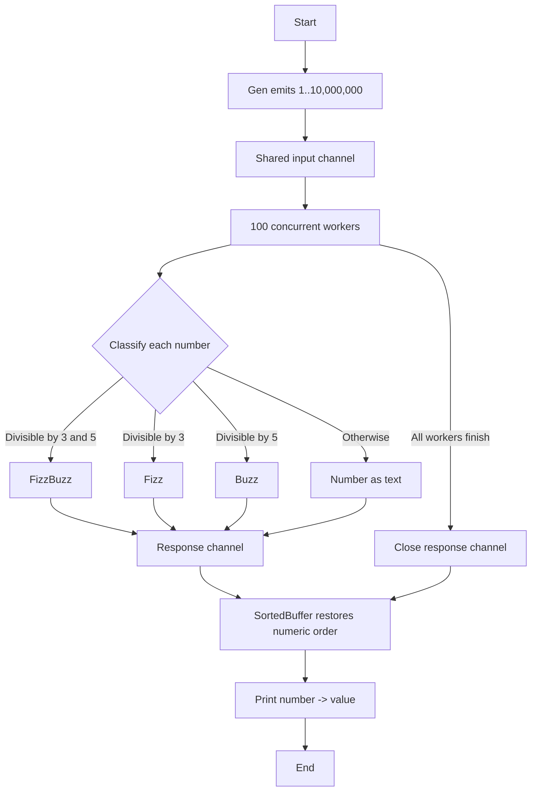

# FizzBuzz Generator

A concurrent Go program that generates numbers, maps them to FizzBuzz values, and prints the results in numeric order.

## Run

```sh
go run .
```

The program processes the numbers from 1 through 10,000,000 using 100 workers. Each number is printed as `number -> value`:

- Multiples of both 3 and 5 become `FizzBuzz`.
- Multiples of 3 become `Fizz`.
- Multiples of 5 become `Buzz`.
- All other numbers remain their decimal representation.

## Workflow


